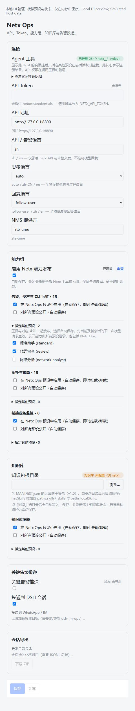

# Netx Ops 工具发布与 UI 修复说明

分析日期：2026-10-11。本次修改在原工作区已有修改的基础上完成，未发布 npm 版本，包版本仍为 0.1.69。

## 结论

问题横跨设置持久化、工具入口、Host 与预设作用域、异步 skill 生命周期和安装模板。单独调整 UI 复选框无法解决。现在四类能力可以独立选择 Netx Ops、指定其他预设或全部预设，且受统一发布总开关控制。

这里的“发布”是向模型注册本插件提供的工具和 skill，不是上传 npm 包，也不是更改 Netx 服务端 API 权限。关闭后，后续模型请求不再获得这些能力；已经发送的模型请求、正在执行的网络操作，以及模型已读入的 skill 内容不会被追溯撤回。

## 原因及处理

1. **分组入口绕过发布设置。** `tools-ops`、`tools-topology` 等旧入口通过 forced 模式强制挂载。现保留兼容导出，但它们只过滤能力组，仍遵守发布策略和总开关。缺少 Host 连接桥接时默认停止发布，移除“自动补回 Host”行为。

2. **关闭值被默认值覆盖。** 布尔值 false 原先可能被解释为 unset；清空目标预设也可能恢复配置默认值。现在保存明确的 false 与空字符串，当前字段优先于旧别名。只有点击“重置”才回到配置基线。

3. **其他预设只有全局公开，缺少定向发布。** 新增按组的预设 ID 列表，并读取当前 Host 的真实预设目录。定向能力注册到每个活跃会话的精确 scope；创建会话、切换预设、策略改变和卸载均同步处理。

4. **Host 与预设重复挂载。** 公开组由 Host 注册一次，再由各预设继承；局部挂载不再重复注册这些组。取消公开后，根据原先保留的 Netx Ops/指定预设选择恢复局部发布。

5. **异步加载在关闭后继续注册 skill。** 分组与知识包加载加入 AbortSignal、代次检查和清理。关闭、重载和卸载会撤销待完成的加载；KB context 也随发布策略重挂载。

6. **部分注册失败留下残余工具。** 工具和 skill 均逐项记录 disposer；发生中途失败时回滚此前注册。连接/知识库订阅者相互隔离，一个订阅者出错不会阻止其他挂载处理。

7. **凭据解析竞态覆盖最新设置。** 策略先同步生效，凭据异步解析按请求代次提交，过期结果丢弃。更换 URL 或凭据引用时不复用旧 token；live snapshot 的空 token 不会在工具调用时回退成旧凭据。

8. **诊断只反映最后一个模块。** 独立构建的 Host 和 tools 入口现在通过进程共享 inventory 记录各挂载的来源、作用域、组、工具名和错误。UI 展示当前 Host 的挂载明细，工具总数按名称去重。这个数字表示注册结果，并不证明 Netx API 鉴权成功。

9. **UI 注册接口不匹配本机 Harness。** 本机实际接口是 `settings.plugin.item`，按设置命名空间 key 匹配卡片；已替换无效的 `plugins.item`。两端严格类型检查以本机官方声明为依据。

10. **自动保存整张表单并丢失快速编辑。** 保存队列现在按字段提交，处理保存期间的新编辑，失败后释放 saving 状态并保留草稿。切换能力组不会保存其他连接草稿；浏览知识库目录仅自动保存 kbRoot。

11. **双安装环境混用模板与配置。** 优先延后读取运行中 Host 的真实 standard 声明，再叠加 Netx Ops；不阻塞 Host 初始发布。仅在旧 Host 不支持读取时按当前 profile 查找模板和依赖，只同步当前 profile 的 patch。预设目录采用受管文件哈希更新，保留用户编辑与附加文件；不再删除整个目录、不写包内生成文件。managed 标记缺失 END 时拒绝截断配置。

12. **拓扑工具目录包含不能执行的能力。** 原生 REST 无法完成 `sinkTopologyDualUnits`，已从原生发布目录移除。拓扑 skill 加入能力说明：高级 dual-unit/orbit/polish 需要对应 MCP；原生布局和分析按实际 REST 实现使用。CLI 执行及拓扑修改工具不再声明并发安全。

13. **表单绑定到空命名空间，或者仅保存到客户端内存。** Harness 的 `configForms.get(id)` 对未知 ID 也返回 placeholder；原代码取到第一个对象即绑定，可能永远等不到真正的 netxops 表单。现在仅选择 ready 的真实 namespace，并在连接前显示等待状态、禁用保存；提交层也拒绝向未连接或只读表单写入。

14. **新版 Host 的 volatile 配置被当成普通标量。** 当前 Harness 的 `.volatile()` 返回稳定引用，须通过 `.get()` 读取。旧 profile 缺少新预设列表字段时，默认空字符串也会被包装，直接调用 `.split()` 就导致插件激活失败；布尔引用还可能使 `false` 被误读。现在保留原始引用，每次操作读取普通快照，统一覆盖连接、语言、凭据引用、超时、安装、告警、分组及 KB 字段。兼容旧 Host 的普通标量；预设解析对非法类型返回空列表。监听当前 Loader 的实例事件 `loader/volatile-update`，在引用提交后立即更新发布策略。

15. **卸载广播触发失效上下文中的重新挂载。** 真实 Cordis 测试发现，Host 卸载时发布关闭状态，部分订阅尚未清理，会再次调用失效上下文的 `effect()`。现在卸载标志同时阻止工具、skills 和 KB 的挂载回调，清理阶段不会重新注册能力。

16. **工具已恢复，但客户端永久等待 Host 设置。** 客户端未声明 `configForms` 注入，却在轮询时直接读取 `ctx.configForms`；Cordis 会拒绝这种访问，延后读取也不会解除限制。候选命名空间还读取了不存在的 `ctx.name`，同样抛出异常，二者都被轮询的 catch 掩盖。现在用 `ctx.get('configForms')` 查询当前可用的可选服务，移除无效命名空间来源，目录选择器也使用可选服务查询。新增已构建客户端在真实 Cordis 中的表单绑定与写入测试，兼容当前 configForms 和旧 settingsScope。

## 现在如何配置

打开设置 → 插件 → Netx Ops，启用“启用 Netx 能力发布”。每组分别选择：

- “在 Netx Ops 预设中启用”：控制内置 netxops。
- “指定其他预设”：勾选任意当前可用预设。清空即撤销全部定向发布；已失效的预设 ID 仍可取消。
- “对所有预设公开”：通过 Host 向所有预设发布，包括 netxops。取消公开不会清空前两种选择。

例如只向标准助手开放运维能力：取消 ops 的 Netx Ops 开关与公开开关，在指定预设中选择 standard。拓扑、割接业务与 KB 均可使用不同目标。

总开关关闭会撤销插件管理的所有 Netx 工具和 skill，保留各组选择。它不控制独立的告警投递开关、会话导出或其他插件/MCP 注册的同名能力。能力选择自动保存；API 地址和手工输入的 KB 路径等连接草稿仍使用保存/丢弃。

组目录当前包含 ops 15 个、topology 15 个、biz-monitor 8 个 REST 工具。知识库另有本地工具及 MANIFEST 声明的 skill 包；实际数量依配置及加载结果变化。

## 实现入口

- `src/netx/capability-groups.ts`：统一发布策略、兼容旧字段和预设目标解析。
- `src/netx/config-values.ts`：按官方跨 ESM/CJS 协议读取 volatile 引用，兼容普通标量。
- `src/netx/preset-publication.ts`：活跃会话的定向作用域挂载与清理。
- `src/netx/group-tools-plugin.ts`：局部工具、skill、KB 的动态生命周期。
- `src/index.ts`：Host 设置桥接、同步策略、凭据解析、RPC 和全局挂载。
- `src/client/card-form.ts`、`controller.ts`、`NetxopsCard.tsx`：提交队列、预设目录和 UI。
- `src/agent-preset-install.ts`：当前 profile 的模板选择与保守安装更新。

## 本机与升级

已核对桌面与 Web 的 `node_modules/dsh-netxops` 均链接到当前 `D:\project\chatgpt\netxops`。本次构建会更新它们共同引用的 `lib/`。需要分别重启桌面 Host 和 Web Host 一次，以重新加载模块与客户端包；日常开关热更新无需重启。

未在运行中的真实 Host 中改变预设选择、重启应用或调用 Netx API。表单写入使用隔离的测试服务，真实凭据与网络设备未参与测试。用户反馈 Netx Ops 预设可以调用工具；随后通过 computer-use 核对正在运行的桌面设置页，客户端热更新后等待提示消失，显示已有连接配置和 23 个已挂载 Netx 工具。

安装器保留用户管理的同名预设，以及无法确认未被编辑的旧 managed 文件，并记录警告。旧版 Harness 的 `.agent-presets` 目录是共享目录；两套 Host 若版本不同，应优先使用各自 profile 的声明式预设。`$DSH_HOME/netxops-mount-status.json` 为旧版诊断快照，两个进程共享 home 时可能互相覆盖；设置页的 RPC inventory 来自各自进程，应以它为准。

本机离线 Web 模板探测发现源码 standard 与已安装依赖的查找结果不一致，缺少 workflow-ptc、tool-present、plugin-manager/tools 等引用。运行时优先从 Host registry 读取 standard 可避免使用另一份源码模板；若旧 Host 只能走文件回退且依赖不完整，安装器会记录错误并保留已有预设。

## 验证与维护

设置页已精简重复的“自动保存”“即时挂载/卸载”和“已覆盖”提示。发布范围使用简短标签，挂载解释与明细集中在折叠的诊断信息中；模型语言独立分组，使用本地化选项。连接字段在宽面板并排、窄面板单列，保存/丢弃栏仅在待处理修改、保存中或保存失败时出现。实际错误仍显示在对应区域。

本次界面验证覆盖运行中的桌面深色设置页、390px 窄屏布局、中英文文案、预设列表展开与选择，以及手工草稿保存后收起操作栏。预览凭据服务为内存模拟，不读取或写入真实 token。预览截图已更新为精简后的界面。

验证命令：

```powershell
bun run bundle
bun run typecheck
bun test
```

回归覆盖目标预设隔离、Host 继承去重、总开关、旧分组入口、注册回滚、异步取消、卸载、快速切换、保存失败重试、空目标、双 profile 与安装文件保留。定向发布集成测试使用本机真实 Cordis 和 dsh-scope 服务上下文。

此前 UI 修复检查：Host/Client 构建成功；严格类型检查通过；133 项测试通过；打包清单检查通过。发布文件清单排除了本机 `.npmrc` 和私有调试控制脚本。

新增启动回归使用本机官方 Schemastery/Cosmokit 的当前源码作为 schema peer，加载已构建的 Host JS；本机安装的旧 `lib` 不支持 volatile 引用，因此单独测试 `Config({})` 无法覆盖新版桌面行为。测试覆盖旧 profile 的缺省字段、新版和旧版配置、开关为 false、保留引用的更新、即时撤销，以及真实 Cordis 中的激活、所属实例事件和无错误卸载。该集成测试使用隔离目录与工具/skill 服务，不连接 Netx 生产服务。

浏览器验证包括选择其他预设、总开关关闭后禁用组控件且保留选择、重新启用，以及自动保存目标时保留未保存的 API 地址草稿。预览使用实际 Card/Controller 和内存设置适配器；运行 `bun run preview:client` 可复查。



实际桌面设置卡片已核对；Web 界面、当前与新会话的定向能力目录，以及配置好的 Netx API token 权限仍需在相应环境验证。高级拓扑 MCP、IM 投递和生产 Netx 服务连通性不包含在本次离线验证中。

## 0.1.70 公开安装与发布检查

发现并修复 Harness 默认 profile 的“注释 + 空列表 `[]`”安装问题：旧实现直接追加预设 block，产生无效 YAML，重启时可能无法加载。现在保留注释与用户条目，转换空列表后再追加；覆盖 BOM、CRLF、文档边界、重装幂等、带引号的用户预设 ID，以及自定义 profile。profile 配置通过同目录临时文件替换，写入前再次核对已有内容。

公开包仅包含八个预编译入口、预设覆盖文件、分组技能、图标、中英文插件元信息和文档，排除源码、测试、开发脚本、本机配置与开发机生成的 standard 快照。公开安装使用包内技能，避免错误读取相邻 `netx` 包的目录。没有安装编译钩子、第三方运行时依赖或隐式 IM/cron 安装。

源码锁文件与公开开发依赖声明已对齐，工作区禁用自动安装 Harness peers；默认构建不再读取开发机的 standard 模板。手工预设安装脚本统一复用正式安装器，去掉先删除预设的行为；不同系统的 peer 链接脚本统一选择同一 Host 的完整依赖集。

新增发布检查核对真实构建输入、预编译输出哈希、导出、客户端注册、声明式 bundle、运行依赖、技能及展示元信息。修改源码但漏构建、修改输出或遗漏文件会阻止发布。`release:pack` 使用与安装测试相同的 npm 打包器，生成 `.tgz` 和 SHA256 校验文件。

本机验证：全新临时源码目录从公共 registry 安装锁定的开发依赖后，可在没有 Harness peers/本机 standard 的情况下完成构建与发布检查；实际 npm 包在中文与空格路径中离线安装成功，没有拉取私有 Harness 包或 React。安装后的独立副本使用真实 Harness peers 激活，挂载 15 个运维工具及包内技能，全部 Host/工具入口可导入，卸载后无残留。测试不更改真实 profile、凭据或生产设备。

当前完整回归为 **137 项通过、0 项失败**；严格类型检查与发布检查通过。Windows/macOS/Linux 的独立构建与离线安装检查已加入 GitHub Actions，跨平台结果以该提交对应的 CI 为准。公开发布流程见 [RELEASING.md](RELEASING.md)。
